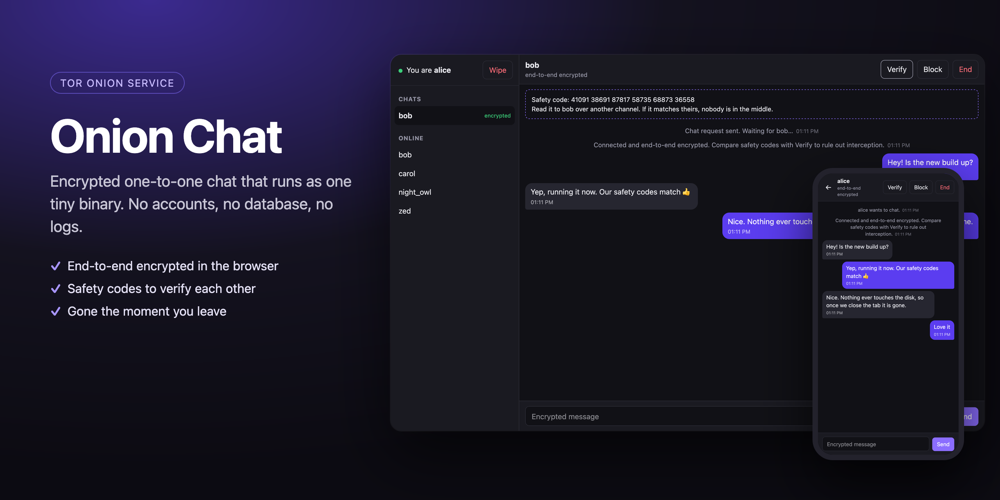
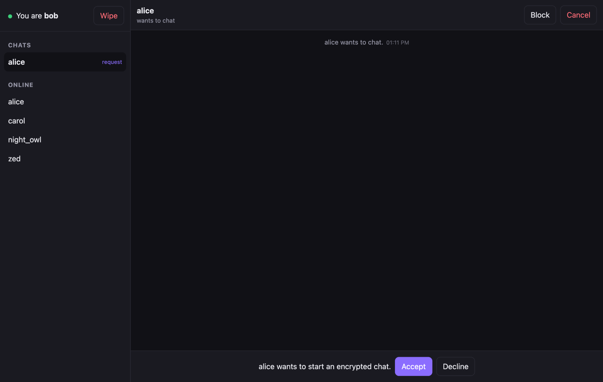
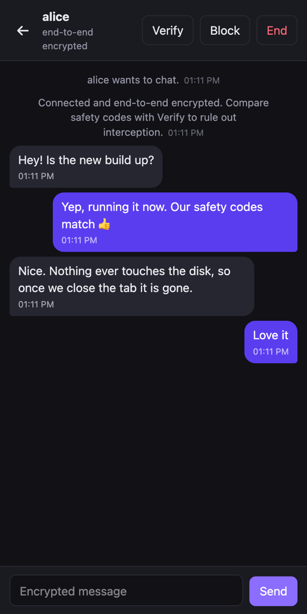
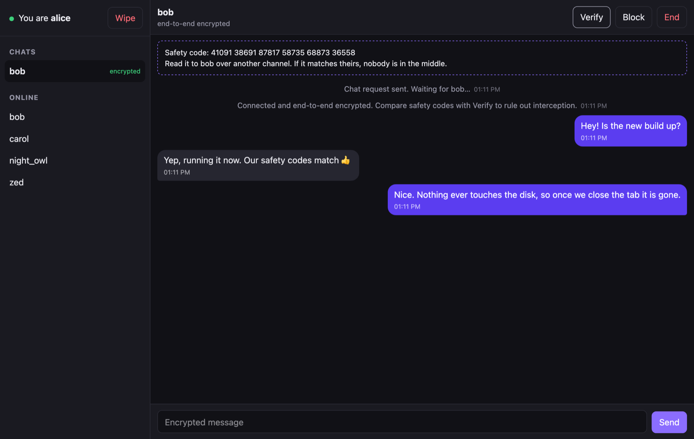

<div align="center">



# Onion Chat

**Private one-to-one chat for Tor. One tiny binary, no accounts, no database, no logs.**


</div>

---

## ✨ Features

| | |
|---|---|
| 🔐 **End-to-end encrypted** | Keys are made in your browser. The server only ever passes along ciphertext. |
| 🧅 **Built for Tor** | Runs as an onion service. No outside scripts, fonts or trackers, and a strict CSP. |
| 🙈 **No accounts** | Pick any username. It's freed the moment you leave. |
| 🗑️ **Nothing stored** | No database, no logs, nothing written to disk. Close the tab and it's gone. |
| ✅ **Verify each other** | Compare a 30-digit safety code to prove nobody is in the middle. |
| 🤝 **Ask first** | Chats start with a request the other person accepts or declines. |
| 💬 **Several chats at once** | With unread counts and a typing indicator. |
| 🚫 **Block** | Ignore requests from someone. |
| 🧨 **Wipe** | One click ends every chat, forgets everything and leaves. |
| 📱 **Works on phones** | Responsive layout, light and dark themes. |
| 🪶 **Tiny** | About 1,100 lines in total. One Go file plus three web files. |

## 📸 Screenshots

<table>
<tr>
<td width="62%"><br><sub><b>Ask first.</b> Nobody can message you until you accept.</sub></td>
<td rowspan="2"><br><sub><b>On a phone.</b></sub></td>
</tr>
<tr>
<td><br><sub><b>Verify.</b> Both sides see the same safety code when nobody is in the middle.</sub></td>
</tr>
</table>

## 🚀 Quick start

```sh
go build -o onion-chat .
./onion-chat                 # http://127.0.0.1:8080
```

To try it, open the address in two different browsers, or in a normal window and a private window.

## 🧅 Put it on Tor

### On a Mac, straight from this folder

```sh
./onion.sh start     # builds the app, starts it and Tor, prints your .onion address
./onion.sh status
./onion.sh stop
```

- Uses the `tor` from Tor Browser, or one from Homebrew.
- Tor's keys and cache stay in `./.tor`, which git ignores.
- Both processes run in a macOS sandbox (`deploy/macos-sandbox.sb`):

| | App | Tor |
|---|:---:|:---:|
| Read this project | ✅ | ✅ |
| Read anything else in your home folder | ❌ | ❌ |
| Write anywhere except `.tor/` | ❌ | ❌ |
| Reach the internet | ❌ (loopback only) | ✅ (it's Tor) |

> [!IMPORTANT]
> `.tor/hidden_service/` holds the private key that **is** your `.onion` address. Back it up to keep the address, and never commit it.

### On a Linux server

```sh
GOOS=linux GOARCH=amd64 go build -trimpath -ldflags="-s -w" -o onion-chat .
scp onion-chat deploy/onion-chat.service you@server:

# on the server
sudo apt install tor
sudo install -m 755 onion-chat /usr/local/bin/
sudo cp onion-chat.service /etc/systemd/system/ && sudo systemctl enable --now onion-chat
sudo tee -a /etc/tor/torrc < torrc.example && sudo systemctl restart tor   # torrc.example is in deploy/
sudo cat /var/lib/tor/onion-chat/hostname
```

The systemd unit runs the app as a throwaway user with no file access, loopback-only networking and no output.

## 🔒 How the encryption works

```
 alice's browser                 server                  bob's browser
 ───────────────                 ──────                  ─────────────
 new ECDH key ── public key ──▶  relay  ── public key ──▶ new ECDH key
              ◀─ public key ───  relay  ◀─ public key ──
 shared secret → HKDF → AES-256-GCM key   (server can't compute it)
 encrypt ───────── ciphertext ─▶ relay ─── ciphertext ──▶ decrypt
```

<details>
<summary><b>Details</b></summary>

- **Key exchange:** ECDH P-256 with a fresh key pair for every chat. Private keys can't be exported and are dropped as soon as the shared key exists, which gives forward secrecy.
- **Encryption:** AES-256-GCM with a key from HKDF-SHA-256 and a random 96-bit IV for each message.
- **Integrity:** sender and recipient names are bound into every message, so the server can't redirect or reflect them. Sequence numbers reject replayed messages.
- **Safety code:** SHA-256 of both public keys. If the server swapped keys, the two codes would differ.
- **Transport:** Tor hides the server's and the users' IP addresses.

</details>

**What the server can see:** who is online and who messages whom, and how often. **Never** what they say.

**What it can't protect against:** a hacked device, or a server operator who changes the page's code. Every web-based E2E app has the second risk, and self-hosting removes it.

> [!NOTE]
> In Tor Browser, use the **Standard** or **Safer** security level. **Safest** turns JavaScript off, and the encryption runs in JavaScript.

## ⚙️ Limits

The limits are constants at the top of `main.go`:

| Setting | Default |
|---|---|
| Users online at once | 500 |
| Messages per user | 10 per second, bursts up to 40 |
| New usernames, server-wide | 5 per second |
| Message length | 4,000 characters |
| Name kept after a dropped connection | 20 seconds |

## 📁 Project layout

```
main.go                       relay server, Go standard library only
web/                          the page: index.html, app.js (all crypto), style.css
onion.sh                      run on Tor from this folder (macOS / Linux)
deploy/macos-sandbox.sb       sandbox used by onion.sh on macOS
deploy/onion-chat.service     hardened systemd unit
deploy/torrc.example          onion service config for a server
docs/                         README images
```

## 📄 License

[Apache License 2.0](LICENSE). Copyright 2026 samiullahsaleem.
